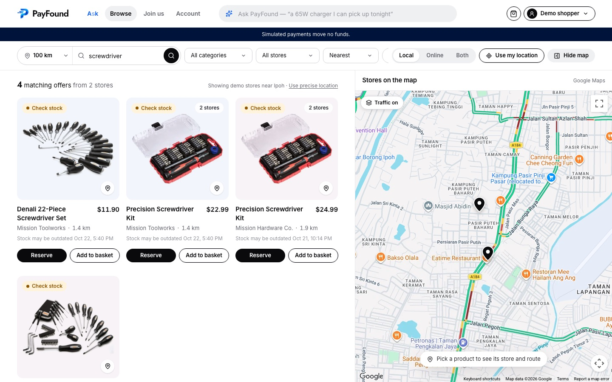
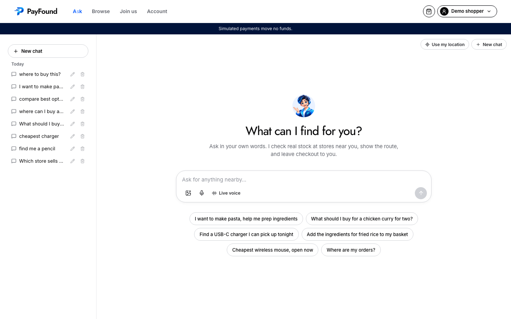
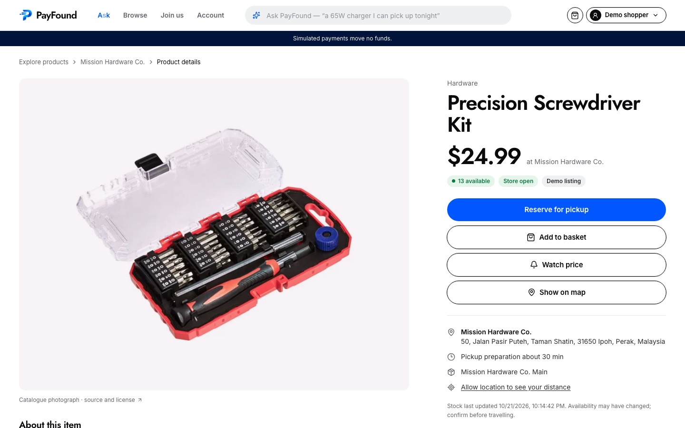
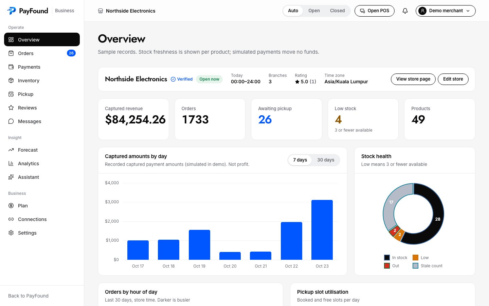
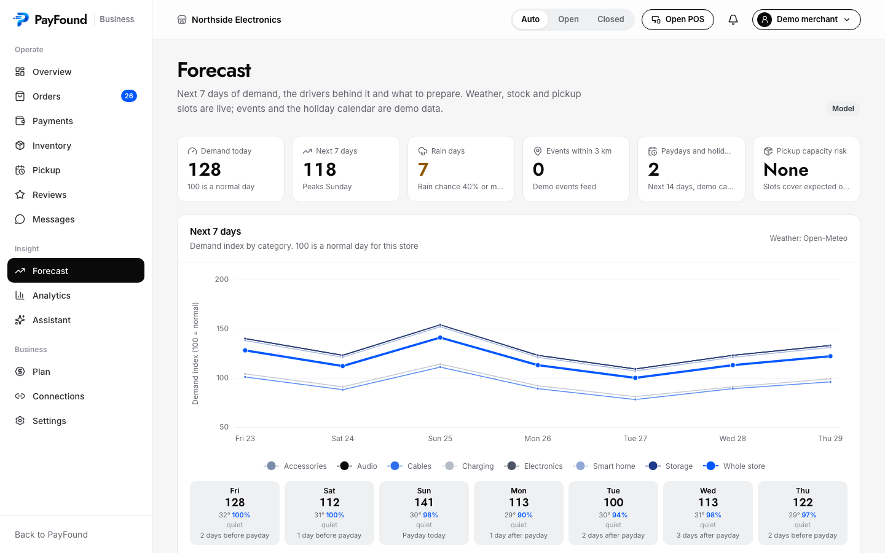
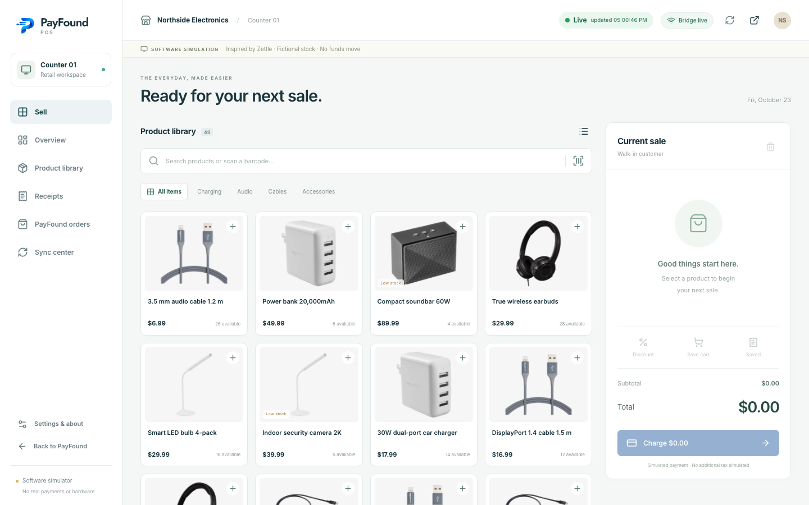
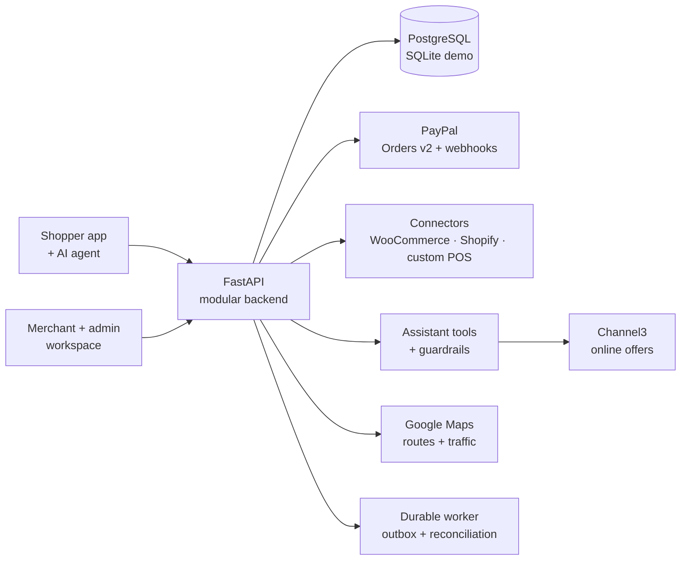

<div align="center">


# PayFound

### Find it nearby. Pay directly. Get it today.

**The world has connected payments, but local products remain disconnected.**<br/>
PayFound connects the two: search the *exact product* in nearby stores (or **just talk to it**), trust the stock you see, reserve it, pay with PayPal, and pick it up.

<br/>

[](LICENSE)
[](docs/TESTING.md)
[](docs/PAYMENTS_AND_SECURITY.md)
[](docs/STATUS.md)
[](#live-demo)

[**The problem**](#the-problem) &nbsp;·&nbsp; [**The idea**](#the-idea) &nbsp;·&nbsp; [**Product tour**](#product-tour) &nbsp;·&nbsp; [**Why it is different**](#why-it-is-different) &nbsp;·&nbsp; [**Sponsor integrations**](#sponsor-integrations) &nbsp;·&nbsp; [**Live demo**](#live-demo) &nbsp;·&nbsp; [**Run it**](#run-it-in-two-minutes) &nbsp;·&nbsp; [**Docs**](#documentation)

<br/>



<sub>Explore: exact products at nearby branches, with distance, price and how fresh the stock is, on a live traffic map.<br/>All stores, prices and stock shown are fictional demo data.</sub>

</div>

<br/>

## The problem

> *"My laptop charger just broke. I need a compatible 65 W USB-C charger in the next two hours, under $60. Where can I collect it?"*

You can find a **shop** a few minutes away. You usually **cannot** find out whether *that* shop has *that* charger right now, whether the branch is open and taking pickup orders, whether the last one is still on the shelf, or how to pay and collect without a wasted trip. So you drive over and hope, or you give up and order online and wait.

Payments are solved. Moving money between a buyer and a seller is a mature, global, instant problem. What is missing is the layer *before* the payment: **trustworthy, fresh, permissioned knowledge of what local stores actually have**, in a form a person (or an AI agent) can act on.

| What breaks | What it looks like |
|---|---|
| **Discovery** | Search shows stores and shippable items, not the exact nearby product. Local merchants are invisible at the moment someone wants to buy |
| **Context** | Needs like compatibility, budget and urgency meet messy store data. A chatbot confidently recommends the wrong variant |
| **Availability** | A feed says "2 left" but the shop is closed, the count is stale, or a walk-in just bought the last one |
| **Execution** | Even after you find it, there is no way to reserve, pay, alert staff and confirm pickup. A results page without an order path is a lead, not a sale |

**It hurts both sides.** Independent retailers already own the stock, the address, the hours and a payment account, but their products stay invisible to people searching online. And AI shopping agents have a model that can understand "65 W USB-C", but no way to know that a shop's last unit sold two minutes ago.

> **The core bet:** for physical commerce, the limit on AI shopping is not model size. It is missing, stale or unpermissioned real-world context. A bigger model cannot see a shelf. Connecting and governing the systems that can is the product.

<sub>Context: the U.S. Census Bureau counted 17.1% of Q2 2026 retail sales as e-commerce; the other 82.9% was not classified as e-commerce. That is market context, not our addressable market. See [the strategy](docs/BUSINESS_STRATEGY.md#41-why-physical-retail).</sub>

<br/>

## The idea

PayFound is a **local-first commerce network**. It sits *above* the tools merchants already use instead of replacing them, and turns their inventory into something shoppers and AI agents can trust.

```text
  Ask or search  ──▶  See honest stock  ──▶  Reserve  ──▶  Pay the merchant  ──▶  Pick up
  "65W charger        "In stock, updated      10-minute      PayPal checkout,       ready-for-pickup
   near me, tonight"   4 min ago, open now,    hold with      merchant stays the     alert, verified
                       1.2 km away"            expiry         seller of record       handover
```

<table>
<tr>
<td width="33%" valign="top">

#### 🛍️ Shoppers
Find the *exact item* at a nearby branch, compare the same product across stores, see the route and the hours, reserve it, pay, and collect. Or just ask the AI agent, or send it a photo.

</td>
<td width="33%" valign="top">

#### 🏪 Merchants
Keep your POS, your brand and your payment account. Publish the inventory you already own, receive pickup orders, and get stock alerts, a demand forecast and analytics. No new storefront to build.

</td>
<td width="33%" valign="top">

#### 🤖 AI agents
Get live, structured, *permissioned* facts about physical stock, with timestamps and evidence, plus safe tools to search, route and plan. Type, send a photo, or **talk to it live**. The agent can help you buy. It can never pay for you.

</td>
</tr>
</table>

### Honest availability is the product

A listed quantity is **never** presented as a guarantee. Every label says how we know and how old it is.

| What the shopper sees | What it means |
|---|---|
| 🟢 **Reserved for you until 5:40 pm** | The merchant confirmed a hold, with an expiry |
| 🟢 **Ready for pickup** | The merchant marked *your* paid order ready |
| 🔵 **In stock, updated 4 min ago** | A fresh reading from the store, no hold implied |
| 🟡 **Likely available. Confirm before you travel** | Fresh feed and good history, but not confirmed |
| 🟠 **Availability uncertain** | Stale or unmapped. One tap to ask the store, try another branch, or go online |
| 🔴 **Out of stock / not taking pickup** | Authoritative zero, or the store can't fulfil right now |

Online results (from [Channel3](https://www.trychannel3.com/developers/)) always appear beside local ones, **clearly labelled ONLINE**, so a retailer's warehouse is never mistaken for the shop around the corner.

<br/>

### 🎙️ Talk to it: live voice

Hands full, driving, or just faster to say than to type? Tap **Live voice** in the assistant and have a real conversation. No typing, no menus.

> **You:** *"Is there a 65 watt USB-C charger open near me right now?"*
>
> **PayFound:** *"Yes. Mission Hardware has one for twenty-four dollars ninety-nine, about two kilometres away, and it's open for another three hours. Want me to put it in the chat so you can reserve it?"*
>
> <sub>Illustrative exchange. Stores and prices in the demo are fictional.</sub>

| | |
|---|---|
| **Real-time and natural** | A live WebRTC session with the OpenAI Realtime API: you can speak, interrupt and follow up, and it answers in one to three short sentences |
| **The same brain as the chat** | It calls the same grounded tools (stock, routes, weather, ONLINE offers) under the same guardrails. Prices are spoken with the currency, distances in kilometres, and rich answers become cards in the chat |
| **Safe by construction** | Only *read-only* tools are ever offered to a voice session. Voice can never pay, refund or change anything; to buy, it hands you the **Reserve** button |
| **Private and bounded** | The browser never sees a long-lived key: the API mints a short-lived session secret. Calls are capped at two minutes on both client and server |
| **Dictation too** | A microphone button turns speech into text in the composer, so you can review it before you send |

Voice works for shoppers and for merchants ("which products should I check this morning?"). It needs `OPENAI_API_KEY`; the details are in [docs/ASSISTANT.md](docs/ASSISTANT.md#voice).

<br/>

## Product tour

<table>
<tr>
<td width="50%" valign="top">

<br/><b>Ask in your own words, or send a photo.</b><br/>
<sub>The agent searches local stock first, widens the search on its own when nothing is close, and shows ONLINE offers next to local results. It plans a grocery basket for a dish, shows the route and weather, and never moves money. Tap <b>Live voice</b> (bottom of the box) to talk instead.</sub>
</td>
<td width="50%" valign="top">

<br/><b>One item, every nearby store.</b><br/>
<sub>Product pages show price, open status, stock freshness and pickup time, and compare the <i>same</i> item across stores using validated identity, never fuzzy name matching.</sub>
</td>
</tr>
<tr>
<td width="50%" valign="top">

<br/><b>A workspace for the merchant.</b><br/>
<sub>What needs attention today, ranked: orders to prepare, low and stale stock, pickup capacity, reviews and payments. Orders, inventory and the pickup calendar sit in dense, fast grids.</sub>
</td>
<td width="50%" valign="top">

<br/><b>An explainable demand forecast.</b><br/>
<sub>Recent trend × weather × local events × weekday × payday × holidays, with stock-out days excluded. It is transparent arithmetic, not a black box, so a merchant can see <i>why</i>.</sub>
</td>
</tr>
<tr>
<td colspan="2" valign="top">

<br/><b>Works with the till they already use.</b><br/>
<sub>A software POS simulator shows how counter sales and online holds share one stock count, how a paused link queues changes and replays them without double deductions, and how conflicts stay visible instead of being overwritten. Real connectors (WooCommerce, Shopify, a custom POS contract) follow the same rules.</sub>
</td>
</tr>
</table>

<br/>

## Why it is different

Local inventory search exists, and we say so plainly. PayFound aims at the part that is still missing: **one trustworthy local order across messy, mixed merchant systems**, from the question to the collected bag.

| Approach | What it does well | The gap PayFound targets |
|---|---|---|
| Maps and store listings | Finding the store, its hours and reviews | They show the shop, not the product on its shelf |
| Feed-based local inventory (Google, Locally, NearSt) | Real reach; shows nearby stock | Feeds lag (Google documents up to 30 minutes), and the flow usually stops at discovery or is specific to one provider |
| Online marketplaces | Assortment, price comparison, delivery | They ship from a warehouse, not the shelf around the corner |
| **PayFound** | Branch-level stock with evidence and freshness, an AI agent grounded in live local facts, reserve and pay in one flow | A new network has to earn merchant density and shopper habit. That is exactly what the pilot is designed to prove |

**Merchants stay the seller.** PayFound is not a payment gateway and not a pooled-funds marketplace. The buyer pays the merchant's own PayPal account, PayFound bills merchant software separately, and nobody has to hand over their customers or their money.

**A good first customer** is an independent store with usable POS stock but little online exposure, selling things people need *today*: electronics accessories and hardware first. The plan is one city, one or two categories and a dense group of stores. Pricing hypotheses, unit economics and the go-to-market are in the [business strategy](docs/BUSINESS_STRATEGY.md).

<br/>

## Sponsor integrations

We did not wire in every [sponsor resource](https://paypalaihackathon.devpost.com/resources). We picked the four the core loop actually needs and made each one **load-bearing**: take any of them out and a real feature stops working. Everything below is called from the running app, lives in the code linked beside it, and is covered by tests or a recorded sandbox check.

| | Sponsor | The job it does in PayFound | Where to see it |
|---|---|---|---|
| 💳 | **PayPal** | Moves the money: checkout, capture, refunds, verified webhooks, merchant subscriptions, order invoices, and read-only payment answers inside the AI agent | `/checkout/:orderId`, merchant *Payments* and *Plan* |
| 📊 | **AG Grid** <sub>Enterprise · AG Charts · AG Studio</sub> | Runs the merchant and admin workspaces: every table, every chart, and a no-code report builder | `/merchant/inventory`, `/orders`, `/analytics` |
| 🗓️ | **Bryntum Calendar** | Plans pickup: capacity per branch per hour, new pickup windows by dragging, and staff cover | `/merchant/pickup` |
| 🌐 | **Channel3** | Puts the online market next to the shelf: ONLINE offers in search and in the agent, competitor price checks, shopper price watches | `/explore`, `/agent`, merchant *Inventory* |

### 💳 PayPal: the whole money path, not just a button

PayPal is the only way money moves in PayFound, so we built the full lifecycle against the sandbox: server-side, idempotent, and reconciled when anything is uncertain.

| PayPal capability | How PayFound uses it | Code |
|---|---|---|
| **JavaScript SDK v6** (React) | `PayPalOneTimePaymentButton` and `PayLaterOneTimePaymentButton`, each rendered only when `useEligibleMethods` says the buyer is eligible. Pay Later is offered, never promised | [`PayPalCheckout.tsx`](apps/web/src/components/PayPalCheckout.tsx) |
| **Orders v2** | Server-locked amount, `intent: CAPTURE`, the merchant's own account as `payee` so they stay seller of record, and a stable `PayPal-Request-Id` on every write. A capture counts only once the order ID, status, capture status, amount and currency all match | [`paypal.py`](apps/api/app/paypal.py) · [`commerce.py`](apps/api/app/commerce.py) |
| **Payments v2 refunds** | Capture refunds with the refund identity saved *before* the readback, so a failed readback recovers through the known refund, never a second one | [`paypal.py`](apps/api/app/paypal.py) |
| **Webhooks** | Signatures verified with PayPal on the original bytes before anything is trusted, deduplicated by event ID, then processed by the durable worker. Capture, refund, reversal and dispute events drive reconciliation | [`worker.py`](apps/api/app/worker.py) |
| **Subscriptions** | Merchant software plans: the catalog product and monthly billing plan are created once, the merchant approves in PayPal, and `BILLING.SUBSCRIPTION.*` webhooks move the local plan | [`paypal_billing.py`](apps/api/app/paypal_billing.py) |
| **Invoicing** | Every captured order gets a PayPal invoice (created, marked sent without emailing anyone, then recorded as paid), retried safely through the outbox | [`paypal_billing.py`](apps/api/app/paypal_billing.py) |
| **PayPal MCP server** <sub>AI Toolkit</sub> | The agent answers *"where is my payment?"* through PayPal's MCP tools behind a strict read-only allow-list. `get_order` runs only after PayFound checks the caller may see that order; transactions, disputes and invoices are admin-only; every `pay_`, `create_`, `cancel_`, `send_`, `update_` and `accept_` tool is filtered out | [`paypal_mcp.py`](apps/api/app/assistant/paypal_mcp.py) |
| **Merchant accounts** | Each store connects its own sandbox REST app. Credentials are checked by fetching (and discarding) an OAuth token, then sealed at rest | [`paypal_accounts.py`](apps/api/app/paypal_accounts.py) |

**Proven against the real sandbox:** OAuth, order creation, test-card approval, server capture and full refund (USD 39.99), repeat-capture checks, and **live signed `PAYMENT.CAPTURE.COMPLETED` and `PAYMENT.CAPTURE.REFUNDED` webhooks** passing PayPal's verification in the real handler. Forged signatures, changed amounts and duplicate deliveries are rejected or acknowledged once with no extra stock effect. Details are in [payments and security](docs/PAYMENTS_AND_SECURITY.md).

### 📊 AG Grid: the merchant workspace is built on it

AG Grid Enterprise and AG Charts Enterprise are registered once with a custom PayFound theme over Quartz ([`grid-setup.ts`](apps/web/src/components/grid-setup.ts)) and power every table in the merchant and admin workspaces. Each grid uses the features that fit its job:

| Screen | AG Grid features | Why it matters |
|---|---|---|
| **Inventory** | `readOnlyEdit` + `onCellEditRequest`, set filters, quick filter, pinned totals row, Excel and CSV export | A stock edit is a *request* to the server. The grid shows the server's answer, never an optimistic local number, which keeps the honest-availability promise |
| **Orders** | Master–detail rows, cell-range selection with integrated charts, column and filter tool panels | Line items open inline; select a range and chart it |
| **Live monitor** | `enableCellChangeFlash` | Price, stock and freshness cells flash when a sale, POS sync or count changes them |
| **Sales pivot** | Pivot mode, row grouping, grand totals, integrated charts, Excel export | Sales by category × branch, one toggle from a pivot |
| **Stock-count sheet** | Editable count column, a computed variance column, range selection, status-bar aggregates | Type what is on the shelf, see the variance, then apply the counts |
| **Overview** | `agSparklineCellRenderer` | A 7-day trend inside each row |
| **Pickup queue** | Today's pickups in collection order with fulfilment actions inline | Sits beside the Bryntum calendar as its third view |
| **Admin console** | Row grouping, set filters, grand totals and charts across merchants, reviews and audits | One console for the platform team |

**AG Charts** draws the overview, the explainable demand forecast and the report pack: a revenue-bar plus 7-day-average line combo, a branch donut that cross-filters the other charts, and an hour-of-day intensity chart.

**AG Studio** is the merchant's no-code report builder ([`AdvancedBuilder.tsx`](apps/web/src/pages/merchant/AdvancedBuilder.tsx)). It receives two live data sources, inventory and orders, and merchants build, name and **save** their own dashboards. The Studio state from `api.getState()` is stored per merchant with optimistic versioning, so two tabs cannot silently overwrite each other, and the server bounds its size and nesting ([`reports.py`](apps/api/app/intelligence/reports.py)). It is lazy-loaded, so it costs nothing until a merchant opens it.

### 🗓️ Bryntum Calendar: pickup capacity you can read at a glance

Pickup only works if a store can hand over what it sold, so the **Pickup schedule** ([`PickupSchedule.tsx`](apps/web/src/pages/merchant/PickupSchedule.tsx)) is built on Bryntum Calendar:

- **Capacity view** ([`PickupCalendar.tsx`](apps/web/src/pages/merchant/pickup/PickupCalendar.tsx)): a `dayresource` view with one column per branch and one block per hour. A custom `eventRenderer` shows *remaining of capacity*, a fill bar and an orders chip, coloured green, amber or red by utilisation, and rich tooltips list every window and its orders. Day, week, month and agenda modes switch between per-branch blocks and all-branch totals.
- **Drag to create a window:** drag across empty time and a sheet opens to set the window's capacity. `onBeforeDragCreate` blocks windows in the past and the server enforces capacity, so the calendar can never oversell a slot.
- **Staff rota** ([`RotaCalendar.tsx`](apps/web/src/pages/merchant/pickup/RotaCalendar.tsx)): staff as resources and pickup-desk and packing shifts as events, with a coverage strip that flags hours that are full, empty or have nobody on the desk. Shifts are generated for the demo.
- **Branch time and rush hours:** everything renders in the branch's time zone, expected rush periods are drawn as Bryntum time ranges, and a PayFound skin over Svalbard matches the rest of the app ([`bryntum-theme.css`](apps/web/src/styles/bryntum-theme.css)).

### 🌐 Channel3: the online market, right next to the shelf

Channel3 answers the question local stock cannot: *what does this cost online?* It is called server-side through one adapter ([`channel3.py`](apps/api/app/intelligence/channel3.py)) and used in four places:

| Where | What it does |
|---|---|
| **Explore and search** | ONLINE offers sit beside local results in their own clearly labelled section, with a disclosure that they never confirm in-store stock ([`merge.py`](apps/api/app/online/merge.py)) |
| **AI agent, chat and voice** | `search_products` returns local *and* online together; `online_offers` retries with fewer words when the full phrase finds nothing. When nothing is close, the agent shows the nearest local match and the online alternative ([`tools.py`](apps/api/app/assistant/tools.py)) |
| **Merchant online price check** | Each product is compared with the cheapest online offer in the same currency, matched by name plus GTIN when known ([`suggestions.py`](apps/api/app/suggestions.py)) |
| **Shopper price watch** | Shoppers watch an item and see *local cheaper*, *online cheaper* or *online deal dropped* ([`PriceWatch.tsx`](apps/web/src/components/PriceWatch.tsx)) |

**Built carefully.** The API key stays on the server, and a script scans the compiled browser bundle to prove it never leaks there ([`check_browser_secrets.py`](scripts/check_browser_secrets.py)). Responses are validated against a strict schema and every link passes a URL safety check. Affiliate URLs are never stored: only price and retailer are cached, with a TTL and a per-request lookup budget. Per-user rate limits protect the credit pool, and without a key PayFound says plainly that online offers are not set up and carries on with local results.

### Also in the box

- **Postman:** a 25-request collection in six folders (health, demo checkout, fulfilment, merchant and admin, PayPal sandbox, security negative cases), each request with test assertions, run with Newman ([`postman/`](postman/)).
- **APIMatic:** the PayPal integration was built with the APIMatic Context Plugin for PayPal in our coding agent, and the exported OpenAPI contract is adjusted to pass APIMatic's validator ([`export_openapi.py`](apps/api/scripts/export_openapi.py)).
- **Render:** a blueprint for the API, the durable worker and the static web app, with a readiness health check ([`render.yaml`](render.yaml)).

<sub>We left Elastic, Zapier, KERNEL and Astropods out on purpose. A one-city pilot does not need them yet, and an SDK we do not use is only risk.</sub>

<br/>

## How it is built

<div align="center">

**Built with**


<br/>


<br/>


<br/>


</div>

<br/>



**Engineering choices that matter**

- **PayPal done carefully.** Server-locked amounts, a stable idempotency key on every write, and a *timeout is unknown, not failed* rule: an uncertain capture is read back from PayPal, never retried blindly. Webhooks are signature-verified with PayPal before anything is trusted. A 100-buyer race for the last unit yields exactly one reservation.
- **An AI agent with a leash.** Tools run as the signed-in user, the model only sees allow-listed fields, and input and output guardrails are enforced in code, not just in the prompt. It cannot pay, refund, change stock or change roles, and its live voice mode is limited to read-only tools.
- **Search that does not give up.** If nothing is nearby it widens the radius, rewords the query and drops a wrong category guess, then tells you plainly how far the nearest match really is.
- **A modular monolith, on purpose.** One API plus one worker is the right size for a pilot. Kafka, Elasticsearch and Kubernetes come when measured load earns them.

Deeper dives: [architecture](docs/ARCHITECTURE.md) · [AI assistant](docs/ASSISTANT.md) · [payments and security](docs/PAYMENTS_AND_SECURITY.md) · [connectors](docs/CONNECTORS.md)

<br/>

## Live demo

PayFound is hosted at **https://payfound.limziyang.ml**.

**An access key is required.** The live demo calls paid services (the OpenAI model and live voice, Google Maps and Channel3), so it is protected by a password to prevent API usage spikes and abuse. Without the key, the site shows an *Enter the access key* page and the API refuses every request.

To get the key:

- **Judges:** the access key, and a PayPal sandbox shopper account for checkout, are in the **testing instructions of our Devpost submission**.
- **Anyone else:** email **limziyang5119@gmail.com** and we'll send you one.

Once you're in, use the account menu at the top right to switch between shopper, merchant and administrator. All stores, prices and stock are fictional demo data, and payments run in the PayPal sandbox.

The gate is built into the app: set `SITE_ACCESS_KEY` on the API to turn it on for your own deployment ([deployment and configuration](docs/DEPLOYMENT.md)). You don't need a key to run PayFound yourself.

<br/>

## Run it in two minutes

You need Python 3.12 and Node 22. The demo runs entirely on synthetic data, so **no API keys are required**.

```bash
python3.12 -m venv apps/api/.venv
apps/api/.venv/bin/pip install -r apps/api/requirements.lock
npm ci --prefix apps/web
apps/api/.venv/bin/python scripts/setup.py
apps/api/.venv/bin/python scripts/dev.py --demo
```

Then open **http://localhost:5173** and use the role switcher to move between shopper, merchant and administrator.

| Try this | Where |
|---|---|
| Search and the map | `/explore` |
| Ask or talk to the AI assistant, including **Live voice** (needs `OPENAI_API_KEY`) | `/agent` |
| The merchant workspace | switch role to *merchant*, then `/merchant` |
| The software POS | `/pos/sell` |
| API reference | http://127.0.0.1:8000/docs |

Optional keys unlock the real integrations (PayPal sandbox, the assistant model, Channel3, Google Maps). Copy `apps/api/.env.example` to `apps/api/.env`; [deployment and configuration](docs/DEPLOYMENT.md) lists every variable, Supabase setup and Render. Demo mode is loopback-only and must never run on a public host. To keep a shared deployment from running up AI, maps or search bills, set `SITE_ACCESS_KEY`: the app then opens on an *Enter the access key* page, and the API refuses every call without the token it issues.

<br/>

## Documentation

| | |
|---|---|
| 💼 [**Business strategy**](docs/BUSINESS_STRATEGY.md) | Problem, market, competition, model, unit economics, go-to-market, pilot gates, risks |
| 🧭 [**Product**](docs/PRODUCT.md) | Every role's experience, availability semantics, page map |
| 🏗️ [**Architecture**](docs/ARCHITECTURE.md) | System design, state machines, store placement, path to scale |
| 🤖 [**AI assistant**](docs/ASSISTANT.md) | Tools, guardrails, search widening, Channel3 fallback, voice |
| 🔐 [**Payments and security**](docs/PAYMENTS_AND_SECURITY.md) · 🔌 [**Connectors**](docs/CONNECTORS.md) | The contracts every change must keep |
| 🗺️ [**Roadmap**](docs/ROADMAP.md) · 📋 [**Status**](docs/STATUS.md) · 🧪 [**Testing**](docs/TESTING.md) | Where it is and where it goes next |

The full index is in [docs/README.md](docs/README.md).

<details>
<summary><b>Repository layout</b></summary>

```text
apps/api/app/              API, auth, commerce and payment saga, PayPal adapter, worker
apps/api/app/assistant/    Agent tools, guardrails, streaming, voice
apps/api/app/connectors/   Encrypted WooCommerce and Shopify sources, sync jobs
apps/api/app/pos_plugin/   Custom POS contract (pull or signed webhook push)
apps/api/app/intelligence/ Grounded merchant tools, Channel3 adapter, consent, reports
apps/api/migrations/       Alembic chain (the schema authority)
apps/api/tests/            Financial, inventory, tenancy and assistant regressions
apps/web/src/              Shopper, merchant, admin and POS interfaces
scripts/                   Setup, local stack, exports and verification
supabase/migrations/       Bootstrap SQL for a fresh Supabase project
postman/, docs/api/        Postman collection and exported OpenAPI contract
sdk/                       Generated Python and TypeScript API clients
render.yaml                API + worker + static web staging blueprint
docs/                      Product, strategy, architecture and runbooks
```

</details>

<details>
<summary><b>Run the checks</b></summary>

```bash
(cd apps/api && PYTHONPATH=. .venv/bin/python -m pytest -q)   # 349 tests, isolated DB, no live provider calls
npm run lint --prefix apps/web
npm test --prefix apps/web
npm run build --prefix apps/web                               # includes the TypeScript check
python3.12 scripts/browser_check.py                           # Playwright journeys; the demo stack must be running
```

More browser and sandbox checks are listed in [docs/TESTING.md](docs/TESTING.md).

</details>

<br/>

## License

PayFound's own source code is released under the [MIT License](LICENSE). Third-party components, template-derived files and the demo photographs keep their own terms; read [THIRD_PARTY_NOTICES.md](THIRD_PARTY_NOTICES.md) before redistributing. Product photographs are credited per image at `/image-credits.html`.

<div align="center">
<br/>

**Connect merchants. Ground AI in live local commerce. Turn discovery into reliable purchases.**

<sub>Built for the PayPal AI Hackathon 2026. PayFound is an independent project, not affiliated with or endorsed by PayPal. All product names and marks belong to their owners.</sub>

</div>
