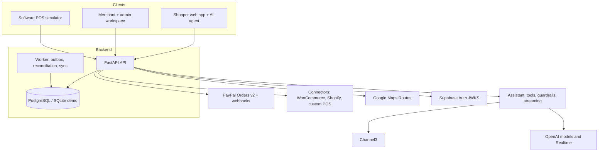
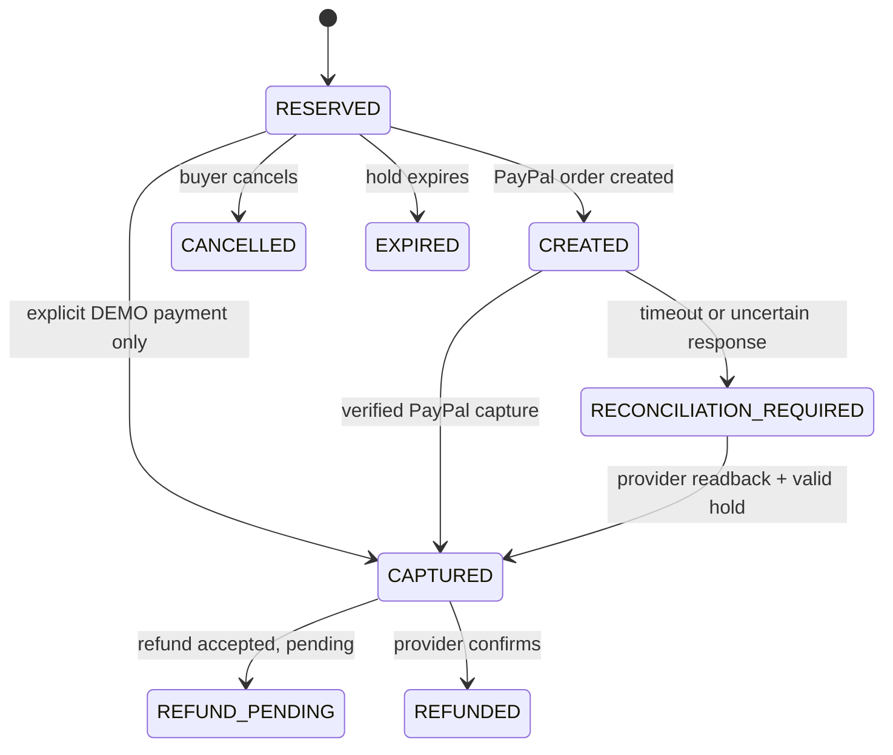

# Architecture

PayFound is a **modular monolith plus a durable worker**. That is the right size for a pilot: one deployable API with clear module contracts, one background worker, one transactional database. Independent services, Kafka, Elasticsearch and Kubernetes are described at the end as measured-need upgrades, not as the current system.

## System overview

| Concern | Where |
|---|---|
| HTTP API, request placement, health | `apps/api/app/main.py` |
| Reservation, payment and refund saga | `commerce.py`, `paypal.py` |
| Auth, roles, tenancy | `auth.py`, `access.py`, `rls`-aware assistant |
| Connectors | `connectors/` (WooCommerce, Shopify), `pos_plugin/` (custom POS), `pos_simulator.py` |
| Assistant | `assistant/` |
| Merchant intelligence, consent, reports | `intelligence/`, `merchant_overview.py`, `forecast_drivers.py`, `report_cards.py` |
| Plans and billing | `plans.py`, `paypal_billing.py`, `paypal_accounts.py`, `paypal_pool.py` |
| Demo-store placement | `placement.py`, `ipgeo.py` |
| Background jobs | `worker.py` (leased outbox) |

Logical modules (`identity`, `merchants and locations`, `catalogue`, `inventory`, `reservation`, `orders`, `payments`, `fulfilment`, `reviews`, `agent tools`, `analytics`, `connectors`, `outbox and audit`) stay separable behind stable function contracts, so any of them can later move behind a queue or become its own service without a rewrite.

## Authority: who owns which truth

| Fact | Owner | Rule |
|---|---|---|
| Physical on-hand stock, POS holds | The merchant's source system | Never overwrite a newer source snapshot with a delayed event; compare source versions |
| Product projection, reservations, order and fulfilment state, permissions, audit, idempotency keys | PayFound database | Single transactional source of truth |
| Capture and refund status | PayPal | Local state reconciles *from* the provider; an HTTP timeout is **unknown**, not a decline |
| Search results | A projection | Checkout always consults authoritative state, never the search index |
| Caches and rate limits | Process memory today, Redis later | Never the source of truth for scarce units |

## Data model

Core tables (see `apps/api/app/models.py` and the Alembic chain in `apps/api/migrations/`, the schema authority):

- **Tenancy and identity:** `merchants`, `merchant_locations` (branch, coordinates, IANA time zone, hours, operational state), `merchant_memberships`, `staff_invitations`.
- **Catalogue:** `products` (per merchant and branch, with quantity, hold quantity, stock timestamp and source), `canonical_products` (validated GTIN identity, used for cross-store comparison). A merchant SKU is never assumed globally unique.
- **Basket:** `basket_lines` (one row per user and product, capped at 10 per product and 30 units, validated against active products on every save).
- **Commerce:** `orders`, `order_items`, `inventory_reservations`, `payment_attempts`, `provider_operations`, `refunds`, `payment_events`, `provider_webhooks`, `outbox_jobs`.
- **Fulfilment:** `pickup_slots`, `pickup_bookings`, `fulfilment_proofs`, `notifications`, `reviews` (verified purchase only).
- **Intelligence and assistant:** `assistant_threads`, consent grants, saved report cards, agent runs (counts and status only, never content), price watches and cached online prices.
- **Connectors:** encrypted connections, scoped publications, location mappings, source variants and sync cycles.

Postgres foreign keys, unique external IDs and transactional conditions carry the invariants. Row-level security is enabled on every table with no browser grants: the browser never reads tables directly, and the API is the only door. The Supabase `service_role` credential stays server-side.

## Reservation and payment

Inventory, payment and pickup are **separate state machines**, never one status.

Fulfilment runs independently: `PAID → ACCEPTED → PREPARING → READY → COLLECTED`, or `CANCELLED` / `EXCEPTION`.

Key properties, each covered by tests:

- **One merchant and branch per basket.** Server-locked totals; the browser is never trusted for amounts.
- **Idempotent reservations.** The idempotency constraint is inserted before stock rows are touched. 100 concurrent buyers competing for one unit yield exactly one reservation.
- **Conditional stock updates.** A single `UPDATE` is the concurrency boundary (a row lock on PostgreSQL, a write lock on SQLite), which also serialises the demo.
- **Stable provider IDs.** Every PayPal write carries a stable `PayPal-Request-Id`. An uncertain create or capture quarantines the hold until readback; it is never retried with a new key and never released on a non-terminal read.
- **Durable provider operations.** Intent is persisted before the call, so a crash cannot lose it. Unknown writes beyond PayPal's deduplication window are never replayed with an expired key.
- **Terminal states are terminal.** A delayed "completed" event cannot resurrect a refunded order. A multi-item inventory decrement is atomic (savepoint) even if a later item has a corrupt hold; the provider capture is kept.
- **Verified webhooks only.** The original body and headers are verified against PayPal before anything is trusted; duplicates are acknowledged once; an unmatched verified event is surfaced to operators rather than guessed at.

Details and the security contract: [PAYMENTS_AND_SECURITY.md](PAYMENTS_AND_SECURITY.md).

## Availability and freshness

Each product row carries the quantity, the held quantity, the time the stock was last observed and its source. Availability to promise is `quantity - hold_quantity`; the shopper-facing label comes from evidence and age, not from the number alone ([PRODUCT.md](PRODUCT.md#availability-labels)). Source freshness for a real connector is expressed as a connector-specific SLA. A 15-second browser refresh shows the data PayFound holds; it is not a claim that the shop's stock is live.

Connector sync follows ordered source versions, a mark-and-sweep that only removes records last seen *before* the current cycle, and periodic full reconciliation, so a push arriving mid-cycle is never erased by an older snapshot.

## Per-viewer store placement

The demo's fictional stores live in San Francisco in the database and are **never rewritten**. A viewer elsewhere would otherwise see stores thousands of kilometres away, so each request is placed around them:

1. The browser sends an approximate anchor (two decimal places) and its time zone in `x-pf-anchor` and `x-pf-timezone`.
2. Middleware resolves a layout for that grid cell: real street addresses on land, validated by reverse geocoding, with a 60 m minimum separation, then stores it in request-scoped context variables. Layouts are cached in memory with a TTL and a per-hour cap on new cells; nothing is persisted.
3. SQLAlchemy `load` and `refresh` events overlay the placed coordinates, address and time zone onto demo merchants and locations with `set_committed_value`, so the session never sees them as modified.
4. A merchant who edited their own coordinates keeps them.

Data requests wait briefly for a layout, otherwise they see the original layout and are told via `x-pf-placement: pending` so the client refetches. The assistant's streaming route waits for the layout and re-applies the placement inside the stream, because context variables do not follow a streamed body. If no land can be found near an anchor, the client falls back through IP city, last known location and time-zone city before accepting San Francisco.

## Authentication and tenancy

- **Production:** Supabase JWTs verified against the JWKS (bounded cache so key rotation is observed), roles from server-set `app_metadata`, **never** `user_metadata`. Membership is checked fresh on every request, even when a signed token still says "merchant".
- **Demo:** an `x-demo-role` header, loopback only, rejected when `DEMO_MODE=false`.
- **Tenancy:** every merchant route resolves the caller's accessible stores; other stores' IDs and missing IDs are indistinguishable (404). The assistant uses the same functions and the same scope check.

## Frontend

React 19 and TypeScript with Vite. Route-level code splitting keeps the merchant libraries (AG Grid, AG Studio, Bryntum) out of the shopper's first load. Data access goes through one API client that attaches the placement headers, waits for a boot gate until the viewer's layout is known, and refetches when it becomes ready. Shared components handle product photos, maps (Google, with a Leaflet fallback), directions and the assistant surface.

## Path to scale

None of this is in the runtime today; each step has a trigger.

| Stage | Change | Trigger |
|---|---|---|
| **Pilot (now)** | One API, one worker, managed PostgreSQL, DB-backed jobs and outbox, explicit finance reconciler | First real merchants |
| **Multi-city** | Move connector sync, indexing and AI work to independent workers; transactional outbox to **Kafka** (Debezium) only if several consumers and replay justify it; **Elasticsearch** for geo and hybrid search only if it beats the Postgres baseline; **Redis** for cache and rate limits; Kubernetes with HPA and KEDA lag scaling for stateless hot paths | Measured throughput, API quotas, backlog or team ownership |
| **Multi-country** | Regional read models and merchant-owned write partitions, per-country settlement and data residency, failover drills | Real cross-border demand |

Principles: PostgreSQL and the merchant source own scarce units, Kafka distributes committed events and never decides who bought the last one, and exactly-once messaging does not give exactly-once effects in PayPal or a POS, so business-level deduplication and reconciliation stay mandatory. Rate-limit per merchant and per provider rather than multiplying traffic when workers scale. Keep customer PII out of replayable events.

Proposed objectives (not measured results): search p95 under 500 ms on a local index excluding slow external calls; uncontended reservation p95 under 150 ms; no duplicate charges from retries; no platform-owned oversell under race tests; reconciliation lag and queue backlog visible with alerts.

**Synthetic capacity example, not a benchmark.** 10,000 stores x 1,000 variants is 10 million location-SKU records. If 5% change daily that is about 500,000 events a day (about 6 per second); if all change twice daily, about 20 million a day (about 231 per second) before bursts, or roughly 20 GB a day raw at 1 KB per event. The harder limits are POS API quotas, SKU mapping and recovering missed events, not Kafka throughput.

`infra/production/k8s/` holds illustrative Deployment and KEDA manifests. They are non-deployable placeholders and must not be presented as an existing cluster.

## Observability and reliability gates

Measure: search p95, stock observation lag, stale-source rate, reservation conflict rate, duplicate-capture count (must be zero), refund reconciliation lag, connector availability and cost per active merchant. The tests that earn trust are listed in [TESTING.md](TESTING.md): last-unit races, capture timeouts, repeated and reordered webhooks, restarted workers, stale source versions and a ten-minute connector outage.
