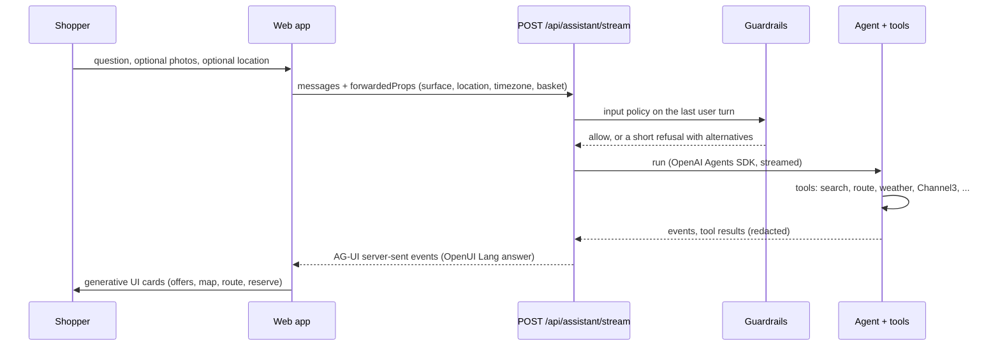

# The PayFound AI assistant

The assistant is the agent interface to the local commerce graph. It exists to turn a messy request ("find me this", a photo, "what do I need for carbonara") into grounded answers and a safe path to buy. It is deliberately **read-only**: it cannot pay, refund, change stock, change roles or contact anyone.

Code: `apps/api/app/assistant/` (backend), `apps/web/src/components/assistant/` and `apps/web/src/pages/ShopAgent.tsx` (frontend).

## How a request flows

- **Protocol.** AG-UI server-sent events: `RUN_STARTED`, tool-call start, args, end and result, text-message chunks, `RUN_FINISHED` or `RUN_ERROR`.
- **Answer format.** The model replies in OpenUI Lang. The frontend renders it with PayFound components (`OfferGrid`, `StoreMap`, `RouteCard`, `WeatherCard`, `CompareOffers`, `ReserveAndPay` and, for merchants, `KpiRow`, `StockAlerts`, `MerchantOrderQueue`, `ReportCard`). These components fetch live, authorised data themselves, so the assistant never repeats a price or stock figure from memory.
- **History.** Threads are stored per signed-in user, with the surface (shopper or merchant) decided by the server. Photos attached to a message are kept with the thread (up to 4 MB each, three per message). Merchant threads are unreadable without current merchant rights.
- **Limits.** Ten tool calls and eight model turns per request, a 90-second run timeout, a per-user request rate limit, and a separate rate limit for Channel3.

## Tools

Every tool runs *as the calling user* by calling the same functions the REST API uses, so the same authorisation, visibility and validation rules apply. The model sees only allow-listed fields.

**Shoppers**

| Tool | Purpose |
|---|---|
| `search_products` | Local store listings, with automatic widening and an ONLINE section (below) |
| `get_product`, `get_store`, `read_reviews` | One listing plus other stores' offers; hours, rating, fulfilment time; recent reviews (untrusted text) |
| `get_route`, `get_weather` | Driving time and traffic delay from the shared location; current weather and the next six hours |
| `online_offers` | Channel3 ONLINE offers with retailer, price, link and image |
| `web_search` | Public web results for specs and model information, never stock or prices |
| `my_orders`, `get_order`, `check_basket` | The user's own orders; validate a single-store basket without reserving |
| `list_recipes`, `plan_recipe` | A grocery plan for a dish: ingredients matched to in-stock listings, the best single store, what is missing, prep steps, a suggested pickup slot |

**Merchants** (membership required, consent-gated for real data): `merchant_dashboard`, `low_stock`, `stale_stock`, `order_queue`, `sales_summary`, `store_reviews`, `pickup_capacity`, `build_report`, and `save_report` (the only write, restricted to a named report recipe for the caller's own store).

**Administrators:** `reconciliation_queue`, `integration_status`, plus a read-only PayPal sandbox status tool bridged over MCP.

## Search that does not give up

Local search used to fail silently: a shopper far from the demo stores, or an over-specific query with a guessed category, returned "nothing nearby". `search_products` now runs several rounds before it concludes anything.

1. **Wording rounds.** From specific to broad: the full phrase, then the head noun and trailing phrases ("flathead screwdriver" becomes "screwdriver"), then leading phrases, then single words, each also without a plural "s". At most eight rounds.
2. **The category is a hint, not a filter.** The model's category guess is tried first and then dropped, because a wrong guess (for example "tools" for items filed under "Hardware") otherwise hides every match.
3. **Constraints relax in order.** `open_now` first, then `in_stock_only`. A price cap is kept.
4. **The radius widens.** The first look is at least 10 km, then 50, 100, 250, 1,000, 5,000 and finally worldwide, so a result always exists if the catalogue has the item.
5. **It reports what it did.** The result carries `widened` (for example `radius widened from 10 km to 250 km` or `no exact match for "flathead screwdriver"; showing results for "screwdriver"`) and `nearest_km`. The assistant is instructed to say plainly when nothing is stocked close by, never to hide a far result as "nearby".

Search runs against the viewer's own store layout (see [ARCHITECTURE.md](ARCHITECTURE.md#per-viewer-store-placement)), and it waits for that layout if it is still being computed.

## Local and online together

Every `search_products` call also asks Channel3 for ONLINE offers, using the same wording rounds, and returns them in `online.listings`. The assistant must show **both** in one answer: local first, then a clearly labelled ONLINE section with retailer, price and link. Online offers are always described as online-only and never as local stock or pickup. A Channel3 failure degrades to local-only; it never blocks the answer.

Channel3 is a catalogue of online retailers, not branch-level stock, and its programmatic checkout is not relied upon.

## Location

The browser owns location permission, and PayFound asks in the page before the first search rather than relying on the browser dialog alone.

- If location is unknown, the in-page card "Share your location?" appears above the composer. **Share** triggers the browser prompt; **Not now** continues without it.
- If the browser has location blocked, the card says how to allow it (site settings, Location, Allow, reload) instead of staying silent.
- If the browser already allows location, it is fetched quietly when the page loads.
- A fresh fix is placed directly into the request context so the *first* message already carries it.
- The question is asked at most once per page load; a failed or dismissed prompt is asked again on the next message.
- Without location, distances are measured from the area centre and the assistant says so; it asks for location before giving travel time.

## Guardrails (enforced in code)

The prompt states the rules, but the code enforces them: `apps/api/app/assistant/guard.py`.

1. **Input policy.** The last user turn is classified into a scope (shopping, orders, basket, recipes, merchant, help) using the server-derived principal, never a client hint. Out-of-scope requests (essays, other people's data, probes for the system prompt) get a short refusal rendered as UI with clickable alternatives. Photos relax the shopping check, since "find me this" has no text.
2. **Data-scope policy.** Each tool is checked against the caller's kind (consumer, merchant, administrator) and, for merchant tools, against the stores the caller may access. Unknown tools are denied by default.
3. **Result redaction.** Every tool result passes an allow-list plus a deny-list before the model sees it. Keys that can carry secrets, identities, margins or costs never reach the model. Strings are scrubbed for emails, secrets and instruction-like phrases.
4. **Output guard.** A rolling window redacts streamed text (emails, secrets, SQL, stack traces, internal identifiers, prompt-leak markers) and can halt a response.
5. **Untrusted data.** Product text, reviews and web snippets are treated as data. Instruction-like phrases are defanged before the model reads them.
6. **Audit.** Refusals and redactions are logged by category, never with message content.

Lesson worth keeping: the result redactor once silently stripped the title, retailer and link from Channel3 offers because a field named `offers` matched the *local product* allow-list. When adding a tool result key, add it to `TOP_LEVEL` in `guard.py` and give nested lists a name that does not collide with `_CHILD_ALLOW`. A regression test covers the Channel3 path.

## Voice

Live voice uses an OpenAI Realtime WebRTC session with an ephemeral secret minted by the API. Calls are capped at two minutes on both client and server. Tools run server-side through `/assistant/realtime/tool` and only read-only tools are ever offered to a voice session. Dictation sends a short clip to the transcription endpoint and returns text for the user to review before sending.

## Photos

A user can attach up to three images (PNG, JPEG, WebP or GIF, 4 MB each). Content is checked against its declared type. The browser downsizes large photos to a JPEG of at most 1,600 px before upload. Only the two most recent image-bearing turns keep their pixels in the model context; older ones become text. For "where can I buy this?", the assistant identifies the item first and then searches its plain name.

## Configuration

| Variable | Purpose |
|---|---|
| `OPENAI_API_KEY`, `OPENAI_MODEL` | The assistant model. Without them the run returns "not configured" |
| `OPENAI_REALTIME_MODEL`, `OPENAI_REALTIME_VOICE`, `OPENAI_TRANSCRIBE_MODEL` | Voice and dictation |
| `ASSISTANT_RUN_TIMEOUT_SECONDS` | Run timeout (default 90) |
| `ASSISTANT_PAYPAL_MCP` | Enables the read-only PayPal MCP bridge for administrators |
| `ASSISTANT_DB_RLS` | Applies row-level-security context to assistant database reads |
| `CHANNEL3_API_KEY`, `CHANNEL3_RATE_LIMIT_PER_MINUTE`, `CHANNEL3_TIMEOUT_SECONDS` | Online offers |
| `GOOGLE_MAPS_API_KEY` | Routing for `get_route` |

## Extending it

- Add a tool inside `build_tools` in `tools.py`; it is wrapped for budget, authorisation and redaction automatically. Its docstring *is* the description the model reads, so keep it accurate.
- Register it in the right set in `guard.py` (`SHOPPER_TOOLS`, `MERCHANT_TOOLS` or `ADMIN_TOOLS`) and add its result shape to `TOP_LEVEL`.
- A tool may never write anything except through an explicit, narrowly scoped, user-requested action like `save_report`.
- Add tests in `apps/api/tests/test_assistant*.py` using the scripted model.

Evaluate the assistant on task completion (right product, truthful status, accepted pickup, no duplicate payment), not on how impressive a reply sounds.
